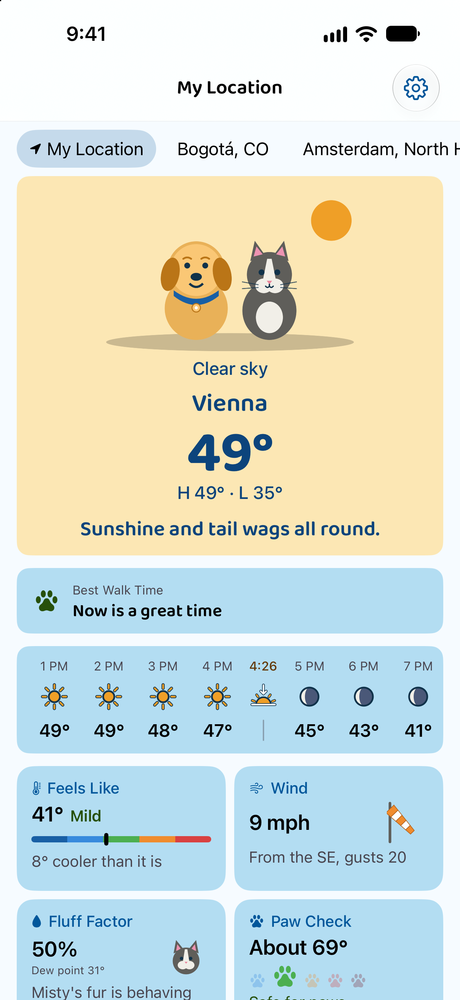
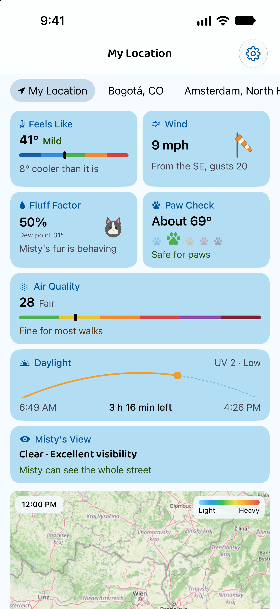
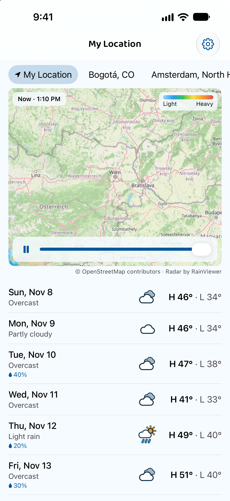
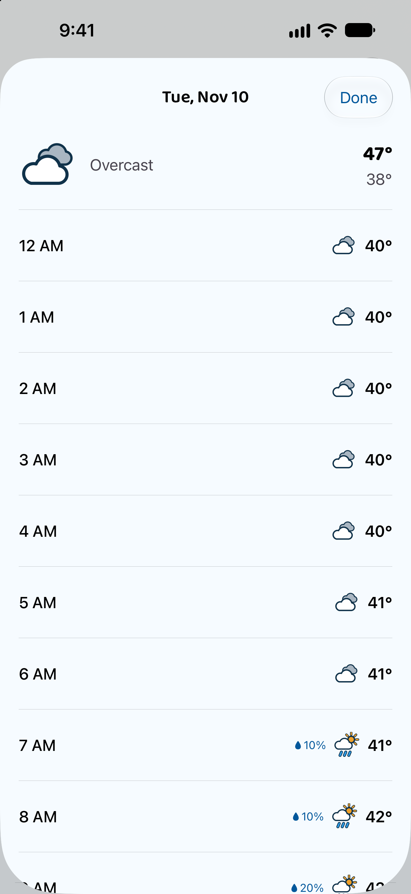
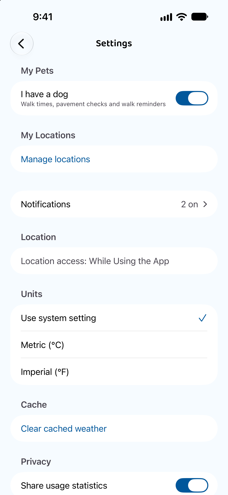
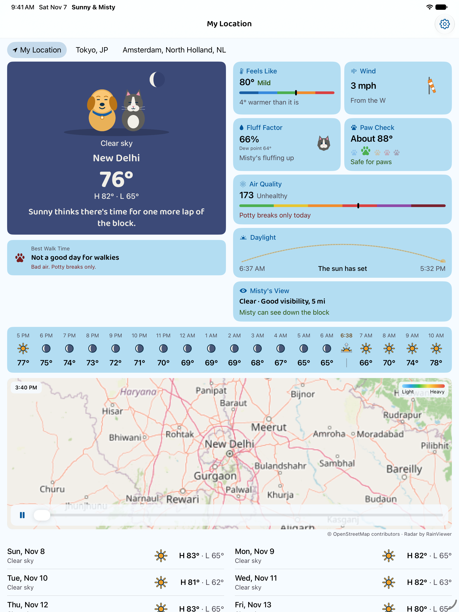

# Sunny & Misty (iOS)


A clean, modern iOS weather app, where Sunny the dog and Misty the cat act out the forecast. Track
current conditions, an hourly and 7-day forecast, and an animated precipitation radar for any
number of saved cities, see when to walk the dog, get a morning briefing, walk-time nudges and rain alerts, and switch
between metric and imperial units. Built with SwiftUI.

There is also a native Android version of the same product, built in Kotlin and Jetpack Compose:
[tuckercr/weather-android](https://github.com/tuckercr/weather-android). The two apps share one design, one
Firebase project and the same Remote Config keys, and new features ship on both.

## Screenshots

| Pets, walk time & hourly | Today tiles & air quality | Radar & rest of week | Day detail | Settings |
|---|---|---|---|---|
|  |  |  |  |  |

On iPad and in landscape, the pets sit beside today's details and the week splits into two columns.
Here New Delhi's air is "Unhealthy", so the walk card says "Not a good day for walkies" and
"Bad air. Potty breaks only.":



The App Store set is in [`screenshots/app-store/`](screenshots/app-store/); see [App Store](#app-store).

## How to run

1. Get a free API key from [OpenWeatherMap](https://openweathermap.org/api).
2. Copy the secrets template:

   ```bash
   cp "Cats&Dogs/Secrets.example.plist" "Cats&Dogs/Secrets.plist"
   ```

3. Edit `Cats&Dogs/Secrets.plist` and replace `your_key_here` with your key.
4. Open `Cats&Dogs.xcodeproj` in Xcode and run on a simulator or device.

New API keys can take up to two hours to activate.

`Secrets.plist` is gitignored so your key is never committed.

Firebase is optional. Without `GoogleService-Info.plist` the app builds and runs normally, with
analytics off and Remote Config on its built-in defaults. See [Firebase](#firebase).

Requires **iOS 17+**.

The app is called **Sunny & Misty** ("Sunny & Misty: Pet Weather" on the App Store). The Xcode project, target
and scheme keep the original Cats&Dogs name on purpose. The bundle ID is `com.fangjet.weather`.

## App flow

1. **Splash**: Sunny and Misty with the "Sunny & Misty: Pet Weather" wordmark.
2. **Welcome**: first launch only; tap **Get started**.
3. **Notification onboarding**: opt in to the 8:30 AM briefing (and, with a dog, walk-time nudges), or **Not now**.
4. **Location onboarding**: use the device location, or **Enter a city manually**.
5. **Current weather**: the main screen for the active city:
   - Hero card: Sunny and Misty act out one of 9 weather moods (fair, sunny, cloudy, rain, storm,
     snow, hot, cold, night) on a mood-coloured card. A clear day follows the Feels Like tile's
     bands: fair (a pale yellow card and the sun) when it's chilly or mild, sunny (amber, Sunny in
     sunglasses) when it's warm, above `walk_comfort_max_c`, and hot from `pet_hot_threshold_c`.
     The card shows the city, temperature, today's high and low (from
     the forecast, over the whole day and taking in the temperature now) and a caption in the
     pets' voice ("Sunny wants puddles. Misty wants a towel."). One caption is picked per day; at
     night it follows the city's time of night (evening, late night, before dawn). The caption
     follows the walk verdict (see **One walk verdict** below): when now isn't the time for a walk,
     captions that suggest one ("Perfect walkies weather! Off we go.") are left out, and when the
     reason is one the scene can't show it speaks to that instead, in place of a seasonal theme's
     caption too: bad air by its pollutant ("Smoky air today. Quick potty breaks, then back on the
     sofa."), hot pavement, or a gale and worse. The moon shows
     its real phase, lit from the other side in the southern hemisphere. Tap the card for today's
     hourly detail. The art is drawn in code as a placeholder, isolated in `PetScene`.
   - **Best Walk Time**: "Now is a great time", the next good hour ("Around 8 AM", or "Tomorrow
     around 7 AM" when it falls on the city's next day), or "Not a good day for walkies" when nothing
     in the next 24 hours qualifies. A good hour is under 30% rain chance (the chance as the hourly
     strip shows it, so an hour shown as 30% counts and one shown as 60% is "rain", not "maybe
     rain"), at a comfortable
     feels-like temperature, between 7 AM and 8 PM, in daylight and with pavement under 40 °C
     (104 °F), and when it is raining now, now never counts, whatever the hourly forecast says. The
     paw is tinted by the rating, and a caption gives the reason when it's more than a wait: the
     pavement now ("Paw check: about 55° now. Too hot for paws."), heat or cold, the air by its
     pollutant ("Smoky air. Potty breaks only.", "High ozone", "Dusty air"), a gale ("Gale force
     winds. Potty breaks only.") or thunderstorms. Hours with unhealthy air (US AQI above 150, or
     Europe's "Poor" and worse; the band is `walk_bad_air_band` in Remote Config) are never
     suggested. At hurricane force the card becomes a "Danger" warning ("Hurricane force winds. Stay
     inside, away from the windows."), shown even without a dog. Hurricane force wind forecast in
     the next 6 hours (sustained, from the hourly forecast) is a warning about later, not a verdict
     on now: the card becomes the same red "Danger" warning, "Hurricane force winds from 6 PM. Get
     everyone inside before then.", while the rating, the hero and its caption still describe the
     hour under way. Likely thunderstorms (60% and up) in the next 6 hours add "Storms from 4 PM."
     to the caption ("Too hot for paws. Storms from 4 PM."), unless it's storming now or the
     outlook already says "Good until 4 PM, then storms." It can be turned off in Settings.
   - **One walk verdict**: `WalkConditions.check` (`WalkCheck.swift`) judges an hour once, and the
     hero's caption, the walk card, the Air Quality tile's note and the notifications all read it,
     so they can't disagree. The screen gets it from `WeatherForecastViewModel.walkAdvice`. Each factor has a small rule and a level, and the worst one wins:

     | Level | When |
     |---|---|
     | Great | Nothing in the way |
     | Fine | A walk, with a caveat: air one band short of bad, for older and flat-faced dogs |
     | Wait | Rain or snow, a near gale (Beaufort 7), pavement getting hot, feels-like outside the comfort range, dark or outside the walking hours |
     | Potty breaks only | Pavement too hot, too hot or too cold for pets, bad air (`walk_bad_air_band`), a gale (Beaufort 8) |
     | Stay in | Dangerously hot pavement, the worst air band, thunderstorms, storm force wind (Beaufort 10) |
     | Danger | Hurricane force wind (Beaufort 12) or gusts |

     The reason carries its detail (the pollutant, the wind's force, the pavement's band) for each
     screen to word. At the same level storms come first, then rain and snow, wind, the pavement,
     heat, the air, cold and the dark. A walk now is fine or better; the hour under way is judged
     by the current reading's feels-like, condition, wind and gusts (with the worse of rain now and
     the hour's storms), the rest by the forecast. With `air_quality_enabled` off the air is left
     out, even from a forecast cached before it went off, and without a dog (*I have a dog* off)
     so is the pavement.
   - **Next rain**: one line under the top card, only when rain or snow is due in the next 2 hours:
     "Rain starting around 3:15 PM", "Rain stopping around 4:30 PM" or "Rain for the next 2 hours",
     from Open-Meteo's 15-minute forecast (0.1 mm in 15 minutes counts; it stops after 30 dry
     minutes). Rules in `Utilities/NextRain.swift`. While the Rain outlook card shows, the line
     becomes its headline instead.
   - **Hourly**: the next 24 hours, with the rain chance under a smaller icon in the icon's own
     space. Every hour is the same height, so the card never changes height with the rain and
     never ends in a gap. Cities without coordinates fall back to
     OpenWeatherMap, which is 3-hourly, so the strip spans three days for them.
     Each sunrise and sunset still to come sits between the hours it falls between, as a slim
     marker: the time ("6:50", the hours either side give AM or PM), a sun on the horizon with an
     arrow up or down, and a thin line. The times are Open-Meteo's daily sunrise and sunset, so the
     evening's strip has tomorrow's sunrise; a day without one (polar day or night) has no marker.
     Cities on the OpenWeatherMap fallback only have today's, from the current reading. VoiceOver
     reads "Sunset, 6:50 PM". Rules in `Utilities/SunEvents.swift`.
   - **Rain outlook**: under the hourly strip (on landscape phones and iPad too), a bar chart of the
     chance of rain for each of the next 10 hours from the hour in progress, shown only when one of
     them reaches 20%. The hourly icon is Open-Meteo's best single model and the chance its ensemble,
     so the two can disagree (a cloud at 70%); the chart makes the outlook plain. The headline is the
     next-rain line when there is one, otherwise "Rain likely around 5 PM" (50% or more) or "A
     chance of rain around 5 PM" ("now" when the first hour is the highest). Then "Drying out after
     9 PM." after the last hour at 20% or more, or "The chance stays up past 12 AM." when that is
     the last hour charted, and the forecast amount over the chart's hours: "About 2.5 mm in all."
     (from 0.5 mm, whole numbers from 10) or "About 0.25 inches in all." (from 0.01 in). A dashed
     line marks 50%. Tapping a bar shows "5 PM · 70% · 2.5 mm" above it, and VoiceOver reads each
     bar the same way. Cities without coordinates chart OpenWeatherMap's 3-hourly slots, with no
     amounts. The card, its hours and the 20% are set in Remote Config. Rules in
     `Utilities/RainOutlook.swift`.
   - **Weather icons** are bundled with the app (vector assets drawn in the pets' style, with the
     pets' navy outline so they read on light and dark cards). Night icons show the moon's phase for
     that hour.
   - **Today**: feels like, humidity, wind ("0 mph" and "Calm" when calm), visibility,
     cloud cover, UV index (daytime only), sunrise and sunset. Visibility is in miles or km to
     match the units (for "Use system setting", the device's measurement system: miles in the US
     and UK), and reads "Clear" from 10 km.
   - **Feels Like**: the feels-like temperature with its band beside it (Cold, Chilly, Mild, Warm or
     Hot), a five-colour bar and how far it is from the actual temperature ("8° warmer than it is",
     or "Same as it is" within a degree). The bands come from the pets' thresholds in Remote Config:
     Cold and Hot at `pet_cold_threshold_c` and `pet_hot_threshold_c`, Mild across the walk comfort
     range, and Chilly and Warm between. The bar's end bands reach 10 °C past the pets' limits.
   - **Wind**: the speed beside a windsock drawn in code, which hangs limp when it's calm and lifts
     steadily until it flies straight out from a strong breeze (24 mph, 10.8 m/s). Underneath,
     where the wind comes from ("From the SW") and the gusts when they're at least 5 mph (2.2 m/s)
     above the wind ("From the SW, gusts 24"); "Calm" when there's none. VoiceOver also hears the
     Beaufort name ("moderate breeze"). Gusts come with the current reading from both providers.
   - **Paw Check** (with a dog): the estimated temperature of dark pavement in direct sun ("About
     128 °F"), five paws from icy to dangerous with the pavement's own full size and colour (blue,
     green, orange, red and maroon), and a line about paws ("Too hot for paws"). Icy and below
     freezing share the blue paw, safe and fine underfoot the green one. The limits are the
     `walk_*_pavement_c` Remote Config keys.
   - **Fluff Factor**: the humidity with the dew point under it ("Dew point 50°"), beside Misty,
     whose fur goes from sleek to full floof as the dew point rises, and her line about it. The
     mugginess goes by dew point, since humidity alone rises and falls with the temperature: Sticky
     from 16 °C / 61 °F ("Misty's fluffing up"), Muggy from 18 °C / 64 °F ("Puffy fur, panting pup",
     or "Misty's getting puffy" without a dog) and Soupy from 21 °C / 70 °F ("Misty has gone full
     floof"). Below that it's Dry under 35% humidity (static sparks, "Dry air, static fur") and
     Comfy otherwise ("Misty's fur is behaving").
   - **Air Quality**: the hour in progress from Open-Meteo's air quality forecast, on Europe's index
     for cities on a European clock and the US AQI everywhere else: the number, its band ("Good" to
     "Hazardous", with "Poor for some" for the US "Unhealthy for sensitive groups"), a six-colour bar
     and a line about walks with a dog ("Fine for most walks") or about people without one. VoiceOver
     also reads the main pollutant ("Mostly ozone"): the one with the highest index, except that
     particles are dust ("coarse particles") when PM2.5 is under a third of PM10 by mass, since a
     dust storm can push PM2.5's index off the scale while PM10 gets none. The walk card, hero and
     notifications name it ("Smoky air", "Dusty air", "High ozone"). It comes with the forecast, in the same request
     the walk planner uses, so it's cached and shows offline. `air_quality_enabled` in Remote Config
     turns it off.
   - The small tiles sit in pairs; when there's an odd one out (Air quality, with Paw check showing)
     it takes the full width.
   - **Radar**: RainViewer's recent radar frames animated over an OpenStreetMap base map, with the
     frame time, a Light→Heavy legend, play/pause and a scrubber. A caption under the map credits
     OpenStreetMap and RainViewer. Frames are refetched once they are 10 minutes old (checked every
     minute while the radar is on screen, and on returning to the app), with the old frames kept up
     until the new ones arrive.
   - **Rest of week**: one row per day (sample closest to local noon) with rain chance (the day's
     highest hour; hidden under 10%, otherwise to the nearest 10%, as everywhere in the app); tap a
     row for each hour's temperature and rain chance.
   - All times (hours, days, sunrise and sunset, radar frames and "today") are in the city's own
     time zone, not the device's.
   - Temperatures are whole degrees with just the degree sign ("89°"), as other weather apps show
     them. `temperature_units_shown` in Remote Config (off) adds the unit where a temperature
     stands on its own ("89 °F"): the hero, the week rows, the day details and the Feels Like and
     Paw Check tiles. The hero's high and low, the hourly strip, the walk card and notifications
     never show it.
   - On landscape phones and iPad the pets and walk card sit beside today's details, and the week
     splits into two columns.
   - City tabs appear under the title once two or more cities are saved.
   - Pull to refresh. On My Location it reads the phone's position first, whatever the 15-minute
     limit below, so My Location moves (by the usual 1 km rule) before its weather is fetched. My
     Location otherwise re-reads the position at launch and when the app returns to the foreground,
     at most every 15 minutes. Data also refreshes silently whenever the app returns to the foreground
     (unless `foreground_refresh_min_minutes` says that city was fetched recently), every 30 minutes
     while the app stays open, and periodically in the background. Each refresh also moves the
     clock on, so hours that have passed drop off and a screen left open overnight keeps up.
   - The hourly strip, the next-rain line, the Rain outlook card, the walk card, the radar, air
     quality and the rest of the week can each be switched off from Remote Config.
6. **Add location**: a full-screen cover, opened from *Add location* in Manage Locations or on the
   empty weather screen, and closed with its X. Results appear right under the field, the name above
   its state and country, with the letters typed so far in bold. Tapping a row adds it (its
   coordinates are saved, so the result is unambiguous). The button above the keyboard says what it
   will do, and the keyboard's Search key does the same: "Add Malmö, SE" adds the first row named what
   was typed (accents ignored, so "Malmo" finds Malmö). Otherwise it asks "Pick a town or city from
   the list", as it also will when a row above the match has `city_search_size_ratio` (20) times its
   population, so "Nas" never adds Nås, Sweden. A place already saved (within 2 km, or the same label
   for a name-only one; My Location aside) is marked *Saved* and its button reads "Go to London, GB",
   which shows its weather. If the search fails (offline, say), the button adds the typed name, which
   is geocoded again at launch, on returning to the app, and when another location is added, the same
   way: the row named as it is, or none. *Add My Location* shows while My Location isn't saved. After
   adding, the app goes back to where it was opened from; Manage Locations confirms with "Malmö
   added".
   - **The search** (SEARCH.md, which Android follows): Open-Meteo's prefix search, so "Nashv"
     already finds Nashville, falling back to OpenWeather's whole-name search if it fails. Only
     populated places are kept (no airports, parks, or historical, abandoned or destroyed towns),
     rows within 2 km with the same label are one place, and places that would still read the same
     get their county. Rows in the phone's region come first, and places with the same name nearest
     My Location first, but neither rule lifts a place past one 20 times its size, so a US phone
     still gets Paris, France before Paris, Texas. Text after a comma narrows the list ("Paris, TX",
     "Richmond, North Yorkshire"), a US ZIP code finds its town, and other postcodes search nothing.
     The six `city_search_*` Remote Config keys tune it. On the OpenWeather fallback nothing is
     sorted, since it has no populations.
7. **Settings** (gear), top to bottom:
   - **My Pets**: *I have a dog* turns on the walk card, the Paw Check tile, the briefing's walk
     sentence and the Walk time notification ("Walk times, pavement checks and walk reminders").
   - **My Locations**: *Manage Locations* to reorder and delete locations (swipe, or Edit), with *Add
     location* under the list. A bell marks the location notifications are for: My Location,
     otherwise the top location. The city tabs on the main screen choose which city it shows.
   - **Notifications**: a row showing how many are on ("2 on", or "Off"), which opens its own screen:
     - Asks for permission if it hasn't been given (in-app while never asked, since iOS has no
       Settings entry yet; a denied one links to this app's notification settings in iOS Settings).
     - Then a switch for each kind: *Morning briefing*, *Walk time* and *Rain alerts*. Walk time only
       shows with a dog, and a kind switched off in Remote Config is hidden. A hidden switch keeps
       its value for when it comes back.
     - With a My Location saved, *Follow my location* (off). With it on and "Always" location
       allowed, iOS wakes the app after a significant move, even when it isn't running: My Location
       moves there (by the usual 1 km rule), the weather is refreshed and the notifications are
       replanned; with the app open, the screen follows the move at once. The background refresh
       also moves it to the last position iOS has. Otherwise My Location only moves while the app is
       open. Turning it on explains why, then shows iOS's one
       "Change to Always Allow" prompt; after that it opens the iOS Settings app. With "Always"
       already allowed it just turns on. It shows on only while "Always" is allowed. Off, the app
       stops watching for moves.
     - Debug builds add *Send sample notifications* (see [Trying notifications](#trying-notifications)).
     - iOS Settings › Notifications › Sunny & Misty links straight to this screen.
   - **Location**: permission status in iOS's words ("Location access: Always" or "While Using the
     App"). Never asked: asked in-app; denied: links to the iOS Settings app. Granting it here adds
     your current location as a city.
   - **Units**: system, metric, or imperial.
   - **Cache**: clear cached weather.
   - **Privacy**: *Share usage statistics* turns analytics on or off. It starts on, except in the EU,
     EEA, UK and Switzerland, where it starts off until the user turns it on.
   - **About**: OpenWeather and Open-Meteo attribution, the
     [privacy policy](https://sunnyandmisty.com/privacy), the [terms of use](https://sunnyandmisty.com/terms),
     and the version at the bottom ("Version 1.0.1" for build 2,
     with "· Debug build" in debug builds).
8. **Update prompts**, from Remote Config: below `ios_min_supported_version` the app shows only
   "Time for an update" with an Update button; below `ios_min_recommended_version` a banner offers
   the update, and *Not now* hides it for a week. Debug builds can show either with the launch
   argument `-updatePrompt required` or `-updatePrompt recommended`.

### Where the data comes from

| Data | Source |
|---|---|
| Current conditions for cities with coordinates | Open-Meteo's `current` reading for the spot, so the hero and Today tiles agree with the hourly strip. OpenWeatherMap's reading is the backup when Open-Meteo fails or `open_meteo_enabled` is off. |
| My Location's name | The phone's own place lookup (Apple's): the town, else the county, else the state. Kept until My Location moves 1 km (`Services/PlaceNames.swift`); "My Location" when the lookup fails. |
| Current conditions for name-only cities | OpenWeatherMap (needs the API key) |
| Town and city search | [Open-Meteo's geocoding](https://open-meteo.com/en/docs/geocoding-api) (prefix search, with populations; data from GeoNames), sorted and filtered on the phone (`Utilities/CitySearch.swift`). OpenWeather's geocoding when it fails, `open_meteo_enabled` is off or `city_search_provider` is `openweather`. |
| Forecast for cities with coordinates | [Open-Meteo](https://open-meteo.com): true hourly data, UV index, and solar radiation for the pavement estimate. Free, no key. |
| Forecast for name-only cities | OpenWeatherMap's 3-hourly `/forecast`, as a fallback |
| Air quality | [Open-Meteo's air quality API](https://open-meteo.com/en/docs/air-quality-api): hourly US and European indices per pollutant, fetched alongside the Open-Meteo forecast. Free, no key. |
| Radar | [RainViewer](https://www.rainviewer.com/api.html) frames (free, no key) at zoom 7, the highest it serves |
| Base map | OpenStreetMap tiles |

Open-Meteo's weather codes are mapped onto OpenWeatherMap-style conditions and icon codes, so the
icons and pet moods work the same for both sources.

### Caching and errors

The last successful current weather and forecast are cached per city in `UserDefaults`. Cached data
is shown immediately while a refresh runs, and is kept on screen if the refresh fails. Errors only
surface when there is nothing cached, with **Retry** where retrying can help (offline, rate limited,
server error) and without it where it cannot (bad API key, city not found).

### Background refresh and notifications

If allowed, the app queues local notifications for one city, My Location when it's saved and
otherwise the first in the list (not whichever tab was last viewed), each kind with its own switch
in Settings:

- **Morning briefing** at 8:30 AM (on): "52° and partly cloudy in Knoxville / High 70°, low 45°, 60%
  chance of rain. Sunny's picked 1 PM for a walk." (the walk sentence only with a dog at home).
  Likely storms later that day add "Storms from 4 PM." before the walk sentence. Hurricane force
  wind that day replaces the walk sentence, and is added without a dog: "Hurricane force winds.
  Stay inside, away from the windows." for the hour under way at 8:30, otherwise "Hurricane force
  winds from 2 PM. Get everyone inside before then."
- **Walk time** (only with a dog): at the first good walk hour today and tomorrow. When that hour has
  already started at 8:30 the briefing says "now's a great time" instead, unless the briefing is off.
- **Rain alerts** (off): up to an hour before rain or snow starts, from the 15-minute forecast,
  between 7 AM and 9 PM city time, once per shower. Switched off for everyone in the first release
  (`rain_notifications_enabled`), since they depend on a background refresh landing in the two
  hours before the rain.

Android works these out at the time (`WeatherNotificationWorker` at 8:30, a one-off `WalkTimeWorker`,
and the periodic refresh for rain). iOS cannot run code at a fixed time of day, so
`NotificationPlanner` works them all out ahead from the cached forecast, and
`WeatherBackgroundRefresher` refreshes that cache in a `BGAppRefreshTask`. Each time iOS grants
background time it:

1. fetches current weather and the forecast for that notification city,
2. writes them to the per-city cache, so the app opens with fresh data,
3. replans the queued notifications from it,
4. does the same fetch and cache for the city tab last viewed, when that's another city, so the app
   opens on fresh data there too, and
5. requests the next run after `weather_refresh_interval_minutes` (default 30, as on Android), or 15
   minutes after a failed fetch of the notification city.

The notifications themselves are on calendar triggers, so they always arrive on time. A week of
briefings is queued, none repeating; each carries that day's forecast, and those beyond it say
"Tap to see today's weather." Each background run, each Settings change and each time the app
itself loads new data replaces the whole queue.

> **iOS decides when background refresh runs.** The interval is a minimum, not a schedule: iOS
> learns from how often the app is opened, and runs nothing if the user force-quits the app or turns
> off *Background App Refresh*. Expect fresher notifications for regular users than for occasional ones.

Background tasks never fire on the simulator. To trigger one on a device, run from Xcode, send the
app to the background, pause in the debugger and enter:

```
e -l objc -- (void)[[BGTaskScheduler sharedScheduler] _simulateLaunchForTaskWithIdentifier:@"com.fangjet.weather.refresh"]
```

The task identifier and the `fetch` background mode are declared in [`Cats&Dogs/Info.plist`](Cats&Dogs/Info.plist),
which Xcode merges with the generated Info.plist.

### Trying notifications

Debug builds only, to see each kind without waiting for 8:30 or the weather. Release builds include
none of this.

**What's sent:** five notifications, 5 to 17 seconds later: two briefings (so a group forms), a walk
nudge, rain and snow. The weather is made up, but the city is the real notification city (My
Location, otherwise the top city), and the text follows *I have a dog* the way the real ones do.

**How to send them** (notifications must be allowed first):

- In the app: Settings › Notifications › *Send sample notifications* (bottom of the screen).
- From the terminal, on a simulator:

  ```bash
  xcrun simctl launch --terminate-running-process CatsDogs-Tests com.fangjet.weather -sendSampleNotifications
  ```

  `--terminate-running-process` matters: if the app is already running, `simctl launch` just brings
  it forward and the argument is ignored.

**Where to see them:**

- With the app open: debug builds show them as banners.
- The Lock Screen lists everything delivered, stacked by kind (briefings, walk, rain). Lock and wake
  the simulator (Device › Lock, then the Home button) if Notification Center can't be pulled down.

**The real ones:** they're planned from the cached forecast (see above), so the quickest way to
replan is to open the app, or change a switch under Settings › Notifications. A simulator needs a
location for My Location:

```bash
xcrun simctl location CatsDogs-Tests set 36.21,-83.29
```

## Architecture

| Layer | Choice |
|---|---|
| UI | SwiftUI, `NavigationStack` |
| State | `@Observable` view models on the main actor |
| Networking | `URLSession` + `Codable` behind `OpenWeatherAPI`, `OpenMeteoAPI` and `GeocodingAPI` protocols, plus an injectable RainViewer fetch (all faked in tests) |
| Persistence | `UserDefaults` via `PreferencesStore`: onboarding flags, saved cities, unit override, walk card and usage-statistics settings, weather cache |
| Location | Core Location (when-in-use) |
| Notifications | `UserNotifications` local calendar triggers |
| Background work | `BackgroundTasks` (`BGAppRefreshTask`) via SwiftUI `.backgroundTask` |
| APIs | OpenWeatherMap `/weather`, `/forecast` and Geocoding (free tier); Open-Meteo; RainViewer; OpenStreetMap tiles |
| Fonts | Baloo 2 for display and title text (SIL OFL, licence bundled), with its line height cut from 1.6 to 1.3 times the size by `scripts/tighten-baloo-line-height.py` |
| Analytics and config | Firebase Analytics (`FirebaseAnalyticsCore`) and Remote Config via Swift Package Manager, both optional |
| Dependencies | Firebase iOS SDK 12.x; everything else is Apple frameworks |

```
Cats&Dogs/
  Config/      API key loading
  Data/        Repositories, PreferencesStore, Remote Config
  Domain/      Units and unit override
  Models/      Weather and radar models, SavedLocation, CitySuggestion, LoadingState
  Services/    API clients, DTOs, forecast aggregation, notifications, background refresh, analytics,
               Firebase setup
  Resources/   Fonts
  Utilities/   Formatting, error messages, brand fonts and colours
  ViewModels/
  Views/       Screens; Pets/ holds the pet scene, moods, walk advice and their thresholds
```

## Accessibility

- VoiceOver labels on every control, including the radar slider (read as the frame's time), the
  hourly weather icons and each Rain outlook bar ("5 PM, 70% chance of rain, about 2.5 mm"). The
  selected unit and the active city tab carry the Selected trait.
- Touch targets of at least 44 pt (radar play button, city tabs).
- Text meets WCAG AA contrast: the light theme's blue is `#01579B` and secondary text uses
  `SecondaryText` rather than the system grey. The brand colour is applied as the app's tint
  explicitly, since iOS 27 doesn't apply the asset catalog's global accent colour.
- Layouts scale with Dynamic Type, up to the accessibility sizes.

## Text and translations

The app is English only for now, but every piece of user-facing text is ready to translate.
Android's equivalent is `res/values/strings.xml`.

- `Cats&Dogs/Localizable.xcstrings` (a String Catalog) holds the app's text: the captions, tiles,
  walk card, notifications and error messages, and the views' text. The English values match the
  keys. Text in views is a `LocalizedStringKey` (`Text("Settings")`, or a helper parameter typed
  `LocalizedStringKey`). Text built anywhere else is `String(localized: "High \(high)°, low \(low)°.", comment: "…")`,
  a whole sentence per case rather than fragments glued together, with a comment for translators.
  Counts use the catalog's plural variations: the notification stack summaries ("%u more
  briefings", looked up by `UNNotificationCategory`) and "Gets dark in about %lld hours."
- `Cats&Dogs/InfoPlist.xcstrings` holds the app's name under the icon and the location permission
  prompts.
- Adding text: write it as above. Building in Xcode adds new keys to the catalog. A command-line
  build doesn't, so either open the project in Xcode once or run
  `xcrun xcstringstool sync "Cats&Dogs/Localizable.xcstrings" --stringsdata <DerivedData>/Build/Intermediates.noindex/Cats\&Dogs.build/Debug-iphonesimulator/Cats\&Dogs.build/Objects-normal/arm64/*.stringsdata`.
  Keep the catalog at `"version" : "1.0"`, which CI's Xcode 16.4 reads.
- Adding a language: in Xcode, select either catalog and add the language with the + button (this
  adds it to the project's known regions too), then fill in each string, or export with Product ›
  Export Localizations and import the translated `.xcloc`. The plural keys get a form for each of
  the language's plural categories.
- Not translated yet: weather descriptions from OpenWeather (the fallback source, requested in
  English), place names from the geocoders (requested in English), seasonal theme captions from
  Remote Config, and dates and times, which use fixed English patterns ("EEE, MMM d", "h:mm a")
  with the device's locale for the day and month names. `TodayDetails.keepUnitsTogether` only
  knows the English unit abbreviations.

## Platform differences

The iOS and Android apps have the same features. Where the platforms differ:

| | iOS | Android |
|---|---|---|
| Briefing, walk time, rain alerts | Planned ahead from the latest cached forecast | Worked out at the time (walk time re-checked when due) |
| Background weather refresh | `BGAppRefreshTask`, no sooner than the Remote Config interval | WorkManager, every 30 minutes (Remote Config) |
| "Use system setting" for temperature | By region | Android 14+ temperature preference, else region |
| Crash reporting | Xcode Organizer crash reports | Crashlytics, release builds only |
| *Share usage statistics* | Settings › Privacy | Settings › About |
| UI tests in CI | None yet | Compose UI tests |
| Release code shrinking | Not needed (Swift compiles to native code) | R8 minification and resource shrinking |

## Tests

Unit tests live in the `Cats&DogsTests` target (XCTest): 238 tests in 24 classes. Run them in Xcode
with **⌘U**, or from the Test navigator.

Shared with Android (the same cases on both platforms):

- `ForecastAggregatorTests`: noon slot selection, multi-day grouping, rain chance, local hour, UV
- `OpenWeatherParsingTests`: JSON decoding for API responses, including UTC offsets and rain chance
- `WeatherUnitsTests`: imperial vs metric by region, Celsius conversion
- `WeatherRepositoryTests`: repository mapping and error handling (fake API), Open-Meteo's reading with OpenWeather as the backup, Open-Meteo switched off by Remote Config
- `OpenMeteoCurrentTests`: Open-Meteo's current reading mapped for the hero, today's range holding the reading
- `PlaceNamesTests`: My Location's name kept until it moves 1 km, failed lookups tried again
- `GeocodingRepositoryTests`: suggestion formatting (name, rest of the label, short label) and validation (fake API)
- `CitySearchTests`: what was typed (names, text after a comma, ZIP codes, postcodes), filtering, merging and county labels, and SEARCH.md's worked examples (Paris, Nas, Springfield, Portland, Birmingham, Sydney, London) against live Open-Meteo rows in `LiveSearchFixtures`; the provider, the 100 rows asked for with a comma, and falling back to OpenWeather (Android's will follow with its search)
- `NotificationWorkerLogicTests`: background fetch, permission and retry behaviour
- `NotificationPlannerTests`: briefing times and text, walk-time nudges, rain alerts (lead, quiet hours, once per shower), the switches
- `OpenMeteoForecastTests`: hour filtering, city time zones (including half-hour zones and DST), WMO codes, UV, pavement heat
- `RadarTests`: RainViewer timeline parsing, tile URLs, load-once and retry, refreshing a stale timeline while the old one stays on screen
- `PetMoodTests`, `WalkAdvisorTests` (both in `PetTests.swift`): mood mapping, night captions by the city's local hour, walk ratings including walking hours, daylight, raining now and pavement heat, Remote Config thresholds, today vs tomorrow in the city's time zone, the 24-hour cap, dropping past hours
- `WalkCheckTests`: the walk verdict's levels for wind (near gale to hurricane force), air (by `walk_bad_air_band`), pavement, heat, cold, storms, rain and the dark; the order of reasons; pollutant names; the walk card's captions and danger rating; hurricane and storm warnings about later; the hero's reason captions and leaving out walk captions; the Air Quality tile following the walk rules
- `MoonPhaseTests`: the phase from the date, checked against published phases
- `WeatherIconViewTests`: icon for each condition by day and night, moon phases, southern-hemisphere mirroring, every asset present
- `CityRepositoryTests`: loading and legacy migration, add (with geocoding and de-duplication), remove, set active, reorder
- `WeatherForecastViewModelTests`: request routing, cache-first display, error mapping, silent background refresh, the foreground-refresh window, analytics events, and races between overlapping requests
- `GeoLocationViewModelTests`: debounced search, latest-input-wins, a failed search told apart from finding nothing
- `AddLocationRulesTests`: Add location's button: the first row named what was typed (accents ignored), the size check that stops "Nas" adding Nås, saved places (label or within 2 km, never My Location) gone to, and failed or empty searches
- `LocationPermissionViewModelTests`: denied, located and failed states, and `LocationRepository`'s position reads
- `WeatherScreenStepsTests`: the weather screen's refreshes, My Location and the notification city
- `SettingsViewModelTests`: unit override persistence, clear cache, permission requests, usage-sharing opt-out, the walk card setting
- `WelcomeViewModelTests`: onboarding flags, including installs that predate the notification step, and the onboarding-complete event
- `AnalyticsRepositoryTests`: the three analytics gates and pushing the opt-out into the SDK
- `PetWeatherThresholdsTests`: walk and pet threshold ranges and pair checks
- `RainOutlookTests`: when the card shows, the headline and detail wording, metric and imperial amounts, the bars' labels

iOS only:

- `WeatherBackgroundRefresherTests`: background refresh caching, notification rescheduling and retry timing
- `PreferencesStoreTests`: per-city cache round trip, eviction when a city is removed, older cache format
- `WeatherFormattingTests`: sunrise and sunset in the city's time zone, UV categories, calm wind, visibility in miles or km and "Clear", temperatures with and without the unit
- `RemoteConfigRepositoryTests`: defaults, the refresh-interval floor, radar-speed, foreground-refresh and Rain outlook limits

View-model tests run against real repositories with scripted API fakes, and a `PreferencesStore` backed
by a throwaway `UserDefaults` suite, so they never touch the app's real data. Shared helpers (including
`Gate`, which holds fake requests open so tests can control the order responses arrive in) live in
`ViewModelTestSupport.swift`.

## CI

GitHub Actions runs on every push and pull request to `main` (see [`.github/workflows/ios.yml`](.github/workflows/ios.yml)).

The workflow builds the app with Xcode 16.4, runs the unit tests on an iOS 18 simulator, and uploads
the `.xcresult` bundle as an artifact for inspecting failures.

The app targets **iOS 17+** so unit tests can run on the simulator runtimes preinstalled on GitHub-hosted Mac runners.

Xcode 16.4's Swift 6.1 compiler crashes on closure default arguments that are main-actor isolated
or read main-actor state. Initializers therefore take optional closures (`fetch: (() -> T)? = nil`)
and fill in the default in the body; keep to that pattern so CI keeps building.

Add the same OpenWeather API key used for Android as a repository secret:

1. GitHub repo → **Settings** → **Secrets and variables** → **Actions**
2. Create secret **`OWM_API_KEY`** with your key

At build time the workflow writes that value into `Secrets.plist` (the file stays gitignored locally).

Optionally add **`GOOGLE_SERVICE_INFO_PLIST`**, the base64 of `GoogleService-Info.plist`
(`base64 -i "Cats&Dogs/GoogleService-Info.plist" | pbcopy`), to build CI with Firebase included.
Without it CI builds with Firebase switched off. Unit tests never start Firebase either way.

## Firebase

Both apps share the Firebase project **`cats-dogs-weather`**, with Google Analytics
linked. The iOS app is registered as `com.fangjet.weather`.

To build with Firebase, download `GoogleService-Info.plist` for the iOS app (Firebase console →
Project settings → Your apps, or `firebase apps:sdkconfig IOS <app id> --project cats-dogs-weather`)
and put it in `Cats&Dogs/`. It is git-ignored; the synchronized folder picks it up with no project
change. Without it, Firebase is never started.

Remote Config parameters are defined and deployed from the Android repo
(`firebase/remoteconfig.template.json`), so both platforms read the same values:

| Key | Default | Used for |
|---|---|---|
| `weather_refresh_interval_minutes` | 30 (minimum 15) | Earliest next background refresh |
| `radar_frame_interval_ms` | 850 (100–5000, otherwise the default) | Radar animation speed |
| `analytics_enabled` | true | Kill switch for every analytics event, and SDK collection |
| `radar_enabled` | true | Hides the radar card if RainViewer or the OpenStreetMap tiles become unavailable |
| `walk_card_enabled` | true | Hides the "Best Walk Time" card for everyone; users can also turn it off in Settings |
| `hourly_forecast_enabled` | true | Hides the hourly strip for everyone |
| `next_rain_enabled` | true | Hides the "Rain starting around 3:15 PM" line (from the 15-minute forecast) for everyone |
| `week_forecast_enabled` | true | Hides the rest of the week's day rows for everyone |
| `rain_outlook_enabled` | true | Hides the Rain outlook card for everyone; the next-rain line then shows on its own as before |
| `rain_outlook_hours` | 10 (whole number 6–12, otherwise the default) | Hours in the Rain outlook chart, from the hour in progress |
| `rain_outlook_min_chance` | 20 (whole number 1–100, otherwise the default) | The Rain outlook card only shows when an hour in the chart reaches this chance of rain; the last such hour is the one "Drying out after" names |
| `daily_weather_notifications_enabled` | true | The morning briefing; off removes the queued ones and hides its switch in Settings |
| `walk_time_notifications_enabled` | true | The Walk time nudge; off removes the queued ones and hides its switch in Settings |
| `rain_notifications_enabled` | false | Rain alerts; off removes the queued one and hides its switch in Settings (keeping the user's choice). Off for the first release |
| `foreground_refresh_min_minutes` | 0 (0–1440) | Skips the silent refresh on returning to the app if that city was fetched this recently. Pull-to-refresh and city changes are never skipped |
| `walk_hot_pavement_c` | 46, about 115 °F (40–70) | Pavement temperature that triggers the hot-paws warning |
| `walk_warm_pavement_c` | 40 (30–65, below `walk_hot_pavement_c`, otherwise 7 below it) | Pavement temperature at which the Today Paw Check tile says "Getting hot" and that hour isn't suggested for a walk (a walk now rates "okay") |
| `walk_dangerous_pavement_c` | 57.2, which is 135 °F (45–80, above `walk_hot_pavement_c`, otherwise 5 above it) | Pavement temperature at which the Today Paw Check tile says "Dangerously hot" |
| `walk_icy_pavement_c` | 0 (−20–10) | Pavement temperature below which the Today Paw Check tile says "Icy, watch for salt" after rain or snow in the last 12 hours or with snow on the ground, and "Below freezing" otherwise |
| `walk_max_rain_chance` | 30 (0–100) | Rain chance at or above which an hour isn't suggested for a walk |
| `walk_comfort_min_c` / `walk_comfort_max_c` | 3 (−20–20) / 27 (15–40) | Comfortable walking temperatures (feels-like); above the maximum, a clear day's hero turns from fair to sunny |
| `walk_hours_start` / `walk_hours_end` | 7 / 20 (0–23) | Local hours walks are suggested in, inclusive |
| `pet_hot_threshold_c` / `pet_cold_threshold_c` | 30 (20–45) / 0 (−20–10) | Feels-like temperatures that switch the pets to their hot and cold moods, and the walk card to "paws hot" and "too cold" |
| `walk_bad_air_band` | 3 (1–5) | Air quality band (0 good to 5 worst) from which a walk is potty breaks only: hours aren't suggested, the walk card and hero say why, and the Air Quality tile says "Potty breaks only today". 3 is US "Unhealthy" and Europe's "Poor"; the worst band (5) keeps pets inside whatever this is |
| `open_meteo_enabled` | true | Off sends the current reading and forecasts for cities with coordinates to OpenWeatherMap (3-hourly) instead of Open-Meteo, and town and city search to OpenWeather |
| `city_search_provider` | `open_meteo` | Where search suggestions come from: `open_meteo` (prefix search) or `openweather` (whole names, at most 5). Anything else uses the default; `open_meteo_enabled` off forces `openweather` |
| `city_search_results` | 8 (3–10) | Most suggestions shown |
| `city_search_country_first` | true | Suggestions in the phone's region go first |
| `city_search_nearest_first` | true | Places with the same name are listed nearest My Location first, when it's saved |
| `city_search_size_ratio` | 20 (2–1000, or 0 for none) | Neither rule above lifts a place past one this many times its population, and Add with nothing tapped doesn't take one from under such a place |
| `city_search_delay_ms` | 280 (100–1000) | Wait after the last keystroke before searching |
| `air_quality_enabled` | true | Off stops fetching air quality: no Air quality tile, and the walk planner ignores the air |
| `openweather_api_key` | "" | Replacement OpenWeather API key, used from the next launch; empty uses the key built into the app. Lets a leaked key be rotated without an update. Not secret: Remote Config values reach every device |
| `ios_min_supported_version` | "" | Below this version (e.g. `1.1`) the app shows only "Time for an update" until it's updated. Empty never asks. Android has its own key |
| `ios_min_recommended_version` | "" | Below this version a banner above the weather suggests updating; "Not now" hides it for a week. Empty never asks |
| `ios_app_store_url` | "" | The App Store link behind the Update buttons; empty hides them until the App Store record exists |
| `tile_feels_like_enabled`, `tile_wind_enabled`, `tile_humidity_enabled`, `tile_paw_check_enabled`, `tile_daylight_enabled`, `tile_sky_enabled` | true | One switch per Today tile (`tile_sky_enabled` is Misty's View, the sky and visibility tile); false hides that tile for everyone |
| `tile_uv_enabled` | false | The UV index tile; while off, UV stays in the Daylight tile's header (it still gets its own tile when there's no Daylight tile) |
| `seasonal_themes_enabled` | true | Seasonal themes (Halloween and so on); false switches them all off |
| `seasonal_themes` | the built-in list | The themes as a JSON list (format: `SeasonalTheme`), replacing the list built into the apps when valid; empty keeps it. A new theme for a fixed date, a date range or an nth weekday needs no app update |
| `temperature_units_shown` | false | On adds the unit to temperatures that stand on their own: "89 °F" rather than "89°", "About 81 °F" on the Paw check tile. Units and the Settings choice are unchanged; the high and low, the hourly strip and notifications have no unit either way |

Walk and pet temperatures are Celsius whatever units the user picked. An out-of-range value falls
back to its default, and if a pair ends up inverted (minimum not below maximum), both fall back to
their defaults.

A missing or unreadable value always falls back to the default, so a console mistake can't break the
app. New values are fetched at most hourly; most apply on the next read (the weather screen works
its state out again as soon as new values are activated), the analytics SDK switch on the next
launch.

### Analytics

The events and parameters match Android, so both platforms report into the same dashboards:

| Event | Parameters | When |
|---|---|---|
| `onboarding_complete` | None | The last onboarding step (location) finished or was skipped |
| `city_added` | `source` (`suggestion`, `typed_match`, `typed_name`, `my_location`), `provider` (`open_meteo`, `openweather`) | A new location was saved (re-adding an existing one doesn't count): how, and which search found it (for a typed name or My Location, the one search would use). Never which place |
| `settings_opened` | None | Settings opened from the gear |
| `weather_error` | `error_key` (e.g. `offline`, `city_not_found`) | A current-weather or forecast fetch failed, even if cached data hid the error |

An event is sent only when all three gates are open:

1. Firebase is configured.
2. The Remote Config kill switch `analytics_enabled` is on.
3. **Settings → Privacy → Share usage statistics** is on. It starts on, except in the EU, EEA, UK
   and Switzerland (by the device's region), where analytics need opt-in consent, so it starts off
   until the user turns it on. Changing it isn't tracked, and clearing the cache keeps the choice.

`FIREBASE_ANALYTICS_COLLECTION_ENABLED` is false in `Info.plist`, so Firebase collects nothing until
the app has applied that choice at launch.

Gates 2 and 3 are also enforced in the SDK with `setAnalyticsCollectionEnabled`, so Firebase's
automatic events (sessions, screen views) stop too.

The app links `FirebaseAnalyticsCore`, so no advertising identifier or ads SDK is included, and
`GOOGLE_ANALYTICS_DEFAULT_ALLOW_AD_PERSONALIZATION_SIGNALS` is off. Firebase ships its own privacy
manifests; see [App Store](#app-store) for the app's own.

Firebase 13 needs Xcode 26.1 (Swift 6.2.1). The project stays on 12.x until CI moves off Xcode 16.4.

## App Store

- [`docs/app-store/listing.md`](docs/app-store/listing.md) is the draft App Store Connect listing:
  name, subtitle, description, keywords and the rest.
- [`screenshots/app-store/`](screenshots/app-store/) holds the 6.9-inch iPhone screenshots
  (1320 × 2868) and the 13-inch iPad ones (2064 × 2752). App Store Connect requires iPad
  screenshots because the app runs on iPad. Taken on 11-07 with the status bar at 9:41:

  | File | Shows |
  |---|---|
  | `01-welcome.png` | Onboarding: meet Sunny and Misty |
  | `02-today.png` | Vienna (My Location) on a clear, mild day: the pets in the sun, "Now is a great time" and the hourly strip |
  | `03-rain-walk.png` | Kigali in the rain: the umbrella scene, "Tomorrow around 7 AM" and the rain chart, "Rain stopping around 4:00 PM" |
  | `04-radar-week.png` | The animated radar and the rest of the week |
  | `05-day-detail.png` | A day's hour-by-hour detail |
  | `06-settings.png` | Settings: I have a dog, locations, notifications, units |
  | `ipad-01-amsterdam.png` | Amsterdam by day, with air quality on Europe's scale and rain on the radar |
  | `ipad-02-delhi.png` | New Delhi at night with unhealthy air: "Bad air. Potty breaks only." |

  Suggested upload order: 02, 03, 04, 05, 06 (01 optional); iPad 02 then 01.
- Release builds fail if `Cats&Dogs/Secrets.plist` is missing or has no OpenWeather key (the "Check
  OpenWeather API key" build phase), so an archive can't ship without one. Debug builds skip the
  check. Radar map tiles are requested with a `SunnyAndMisty/<version>` User-Agent and cached on
  disk, as OpenStreetMap's tile policy asks.
- [`Cats&Dogs/PrivacyInfo.xcprivacy`](Cats&Dogs/PrivacyInfo.xcprivacy) is the privacy manifest: no
  tracking or tracking domains, product interaction data for analytics and precise location for
  app functionality (neither linked to the user), and `UserDefaults` as the only required-reason API.
  The App Store privacy answers in `listing.md` cover this plus what the Firebase SDK collects itself
  (coarse location and a per-install ID, for analytics).
- `ITSAppUsesNonExemptEncryption` is false in `Info.plist`, so uploads skip the export-compliance
  question.
- The app icons have no alpha channel, which App Store Connect requires.
- The privacy policy is at [sunnyandmisty.com/privacy](https://sunnyandmisty.com/privacy) and the terms of use at
  [sunnyandmisty.com/terms](https://sunnyandmisty.com/terms), both linked from Settings › About.
- **TestFlight**: create the app record in App Store Connect (bundle ID `com.fangjet.weather`, SKU
  and name from `listing.md`), archive `main` in Xcode (Product › Archive, signing with FangJet LLC,
  team `3V3NR8HP58`), and upload from the Organizer. Bump the build number (`CURRENT_PROJECT_VERSION`)
  for every upload. Internal testers must be users on the App Store Connect team; external testers
  only need an email address, but the first build for them goes through Beta App Review.

## Credits

Weather data by [OpenWeather](https://openweathermap.org/) and [Open-Meteo.com](https://open-meteo.com)
(CC BY 4.0). Location data based on [GeoNames](https://www.geonames.org), through Open-Meteo's search. Radar by [RainViewer](https://www.rainviewer.com). Base map ©
[OpenStreetMap](https://www.openstreetmap.org/copyright) contributors. [Baloo 2](https://github.com/EkType/Baloo2)
by Ek Type, under the SIL Open Font License.
